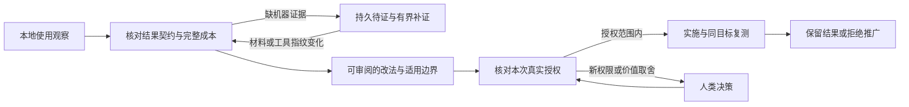

# Agent Token Usage 改进：产品与恢复合同

状态：`合同已固化，首个离线反馈切片已实现`。当前增加显式审阅的原生调用/结果材料关联，详见 [首切片合同](agent-command-usage-phase-five-first-slice-contract.md)。开发验证工作流的真实调用与自然生产观察分开；后台产品实现仍待真实观察门槛。没有新增后台采集、建议数据库、自动修改、远程遥测或产品界面。

## 能力、参与者与选择

Agent 和用户能依据同一目标的结果与完整成本，自主选择改进方式。减少 Agent 介入轮次、Agent 输出、Agent 输入，是降低 Cost、减少 Context Rot 带来的能力下降，并维持或提升 Agent 能力的观察维度。长命令简化是其中一个切入点。

采用现有分析入口、冻结输入、私有证据与白名单HTML作为第一版观察面。长时作业如有实际需要，复用通用 `task command-execution` 的所属执行、材料绑定、一次结果交回、Stop和重启恢复，不另建优化专用调度器。已有能力见 [分析工具](agent-command-usage-analysis-tool.md)、[通用命令托管](task-owned-command-execution-and-result-delivery.md)。Exploratory Findings面向探索会话，不作为所有命令的自动写入目的地；Issue投递也不在本合同内。

只补示例不能持续验证成本；立即做全局采集和自动改代码会扩大权限与数据范围。因此选择按需、先证语义的方案。现有报告与恢复路径可复用，新后台服务没有必要；生产目标归属及误报可控尚未证明，不能把合成通过当成该前提成立。

## 改进选项与轻量记录

以下提供选项和记录方式，不增加固定选择顺序、复杂场景规则或新例子库。何时采用、选哪个工具及是否组合，由模型根据当前目标与已有授权判断。

| 可选方式 | 改变什么 |
| --- | --- |
| 使用现成工具或改善指引 | 减少重复发现工具、撰写命令与解释的负担。 |
| 精简或复用脚本 | 减少 Agent 重复输出，保留必要的结果与错误语义。 |
| Batched Scripts | 将原本分散的多个调用组合为一次执行，减少模型介入和往返；保留逐项结果与可定位错误。批处理本身不要求并行执行。 |
| 纳入自动化或整合既有脚本/流程 | 由已有流程执行合适的工作，减少 Agent 手动调用；可以直接集成工具，不必先创建独立脚本。 |
| 精炼返回与按需详情 | 默认给 Agent 有效摘要，详细信息保留可查；出错时直接提供相关步骤、原因及必要诊断信息。 |
| 保留、调整或回撤 | 按证据决定现状或既有改进是否继续适用。 |

执行方式与上下文提供方式分别选择，自动化不要求自动注入完整返回。返回精炼不能隐去必要结果或诊断，按需读取详情的实际成本也应计入。模型自行判断当前所需信息，不在这里硬编码适用情形。

每项改进沿用现有报告或记录载体，简记下表即可；这不是新增生产schema、状态机或自动采集承诺。

| 记录项 | 内容 |
| --- | --- |
| 目标与证据 | 要完成什么，来源/版本及必要证据入口；不复制整份转录。 |
| 选择与理由 | 采用哪些选项、使用哪个工具，简述理由和适用范围。 |
| 前后观察 | Agent 介入轮次、输出、输入；工具调用数另记。实际费用及能力表现有证据则记录，缺失为unknown；字符数只作代理量。 |
| 返回约定 | 直接提供的精炼信息、出错时相关诊断、详细材料入口。 |
| 当前结论 | 单项或整体收益、代价、能力表现和未知项；可以记阶段性或部分优化成功。 |
| 后续复查 | 哪些证据或变化值得复查，以及调整/回撤的理由或依据；新结论不覆写旧观察。 |

减少轮次或token可以构成某一维度的优化成功，但不意味着同时证明所有目标、适用于所有场景，或未来不可回撤。降低费用、降低无效上下文负担、维持或提升能力分别保留观察；不预设每项改进都必须同时改善三者，也不把这些指标机械合成为单一分数。

## 方法论与Skill的后续交付

本任务从实际尝试中提炼可迁移的改进元Skill，沿用上述选项与记录框架，入口保持简洁，领域细节按需读取。[初版源码](../.codex/skills/agent-workflow-cost-and-context-effectiveness-improvement/SKILL.md)已经创建，包含独立的按需记录模板；不把本分析器或Cline Kanban操作步骤设为通用前提。跨流程有效性继续由后续应用验证。

按用户选择的第二条路径，由独立后续任务结合Software Factory设计，先联合轻量应用于RVF和base-branch-sync，再在overhaul完成的完整Factory（含届时新增的Cline Kanban内容）中应用。每轮均用实际效果修订同一份元Skill；不为每家复制不同版本，不要求初版先证明所有流程有效。承接范围与进入条件见 [路线](agent-command-usage-optimization-roadmap.md#元skill与跨流程打磨路线)。

## 本轮实施合同（PLAN-READY）

用户已授权继续实施，并允许重整早期实现。本轮复用原分析器、输入清单、冻结产物与测试设施，落实以下有界切片：

- 能力与范围：同一入口可批量分析多份清单，每份保留结果、错误及重放；分析流水线自动形成精炼回执与详情入口。统计可观察的工具返回字符量，与已知命令撰写量、调用数并列，模型轮次、token、费用和能力变化缺证仍为unknown。
- 选择与记录：元Skill提供可组合手段和按需读取的轻量记录模板；从本轮实际尝试记录效果、代价、适用范围与调整/回撤依据，不自动替模型选择改法。
- 边界：只执行已有固化对照，不执行转录业务命令；保持私有材料边界。跨流程实施仍由REA-36承接，当前不新增后台采集、全局自动触发或通用脚本执行平台。
- 落点：既有Python分析入口、聚合/HTML、guarded测试、使用文档与仓内可引用的通用Skill源码。
- 验收：单份调用兼容；批量中一份失败不丢其他独立结果；回执含关键异常和详情入口且不倾倒原始输出；未知与0分开；缓存/冻结恢复及公开隐私原回归继续通过。Skill格式校验、实际材料试用和浏览器验证均保留证据。
- 验证：先补失败测试，再最小实现；运行原guarded分析回归、根typecheck及相关lint。此处为离线Python与Skill源码，不涉及运行时构建输出。

当前已落实多清单顺序批处理、逐项异常、自动精炼回执、返回字符的观察与unknown区分，以及元Skill初版。原分析流水线自动完成解析、统计、对照与摘要，减少额外人工拼装；不据此宣称模型轮次、实际费用或能力变化已经测得。后续由真实记录和复查继续完善。

## 流程与状态

下列状态是产品合同语义，尚未加入生产schema。状态每次变化保留原始证据、原因和版本，不覆写历史失败。

| 状态 | 进入与可执行动作 | 退出条件 |
| --- | --- | --- |
| `usage_observation_pending` | 原生执行已完成，但目标或成本未审定；可只读解析、抽样 | 足够证据进入建议，缺机器事实进入待证 |
| `machine_evidence_pending` | 保存具体缺口、等价来源、恢复指纹与已用预算；继续独立目标 | 证据语义变化后自动补验；同指纹不无限重试 |
| `optimization_recommendation_ready` | 展示结果契约、替代、反例、已知成本与unknown | 核对已有授权；新权限/真实取舍才交人 |
| `human_decision_required` | 只暂停依赖新权限、数据外发或价值取舍的动作 | 有可核对原话及范围的决定；时间流逝不构成同意 |
| `authorized_change_in_progress` | 只实施已绑定的目标和变更范围 | 冻结实现及指引版本后进入复测 |
| `same_goal_retest_pending` | 先检查结果、身份、权限与错误，再比成本 | 合同成立后记录保留；退化则拒绝推广并保存反例 |
| `optimization_resolved` | 记录通过、拒绝或因证据不足保留原方案的结论 | 代码/指引/材料改变时新建关联修订，不篡改旧结果 |

明确Stop、取消和权限撤销作为独立restriction持久保存，优先于上述状态。机器待证不得解除restriction；模态待答也不被成本优化建议绕过。历史接受事实、当前状态、下一动作资格分别核对。

## 观察与结果合同

每次观察绑定输入清单、原生执行定位与材料摘要、分析器、配方、指引和工具版本。可信存在时记录workspace、task incarnation和conversation身份；缺失为null，不从cwd、目录名或裸taskId推导。`operationGoalObservationId` 只接受明确原生关联或受控fixture关联；候选目标族不冒充同目标链。

结果定义至少包含输出形状、目标/会话归属、允许的排版差异、错误传播、权限和副作用。已知command字符、输入准备字符、额外工具调用、修正次数与完整目标成本分开；包含关系不重复相加。外层payload、复制/转义、一次性工程投入和真实token/耗时缺证时保留unknown。一次性保存脚本与复用后的调用成本同时展示。

现有实现尚未自动采集完整 Agent 介入轮次、模型输入/输出token、实际费用或能力变化。新记录框架不能把已有字符统计或开发试点追认为这些目标的验证结果。

生产观察必须绑定实际可用的工具/指引版本及可信目标链。只看非零退出、重试或低调用量只能产生调查线索；机会分母和替代入口未知时，不判功能无用或自动下线。跨版本相关性不单独证明因果。

## 机器补证、重启与幂等

| 缺口/故障 | 等价证据与自动动作 | 预算、进度与恢复条件 |
| --- | --- | --- |
| 原始路径轮转或迁移 | 复用清单绑定且摘要一致的冻结来源，保留原失败 | 原分析器已实现；每份材料指纹尝试一次，显示主来源/替代来源状态 |
| 原生身份或同目标链不足 | 只读材料明确指向的原生元数据和任务会话记录；仍缺时保留null | 不扫描无关HOME，不要求用户代查；阻止通用API推广，继续局部配方及合成目标 |
| jq等工具不可用 | 按实际依赖暂停配方，继续已验证Python替代 | 不自动安装、不把未运行写通过；工具指纹变化后重新核验 |
| 对照失败或质量退化 | 保存失败场景、stdout/退出状态与源版本，修复已授权范围 | 源或fixture指纹变化后重跑相关检查；不能仅改期望结果消除失败 |
| 分析中断或机器重启 | 核对完成清单与全部摘要，再复用完整观察或整体只读重放 | 不执行转录命令；半成品不是完成，新结果原子发布 |
| 快照中断 | 核对私有目录、目标、旧快照和确属本次的暂存；重新只读查询 | 不提升未验证暂存；SIGKILL残留不能当成功；旧文件继续可读 |
| 长时所属执行或结果投递缺证 | 复用已有监督进程、语义补证、原生受理回执和稳定结果ID | 沿用通用预算与撤销；先证明未提交才重投，不创建另一条发送链 |

当前按需分析的恢复触发点是下一次原入口调用；没有后台自动扫描承诺。将来若批准长时作业，先登记通用所属执行及只读语义观察器，持久化恢复条件后才可自动接续。无变化诊断时间戳不刷新预算，重启不清零预算。

## 数据生命周期与权限

默认本地、按需、显式来源和显式持久输出目录。沿用分析器700目录与600文件；只冻结明确声明且重放所需的执行/结果材料，不额外复制整份会话、不云端同步或全局HOME扫描。原始输入由其所有者管理，本工具只读。清理只针对有本工具归属且未被审阅/重放引用的派生产物，不删原始来源或被绑定的评审原件；本期不新增定时清理。

公开报告仅白名单聚合和明确编写的合成配方，不含真实原始命令、路径、执行/会话ID、业务正文或stderr参数值。外发和共享私有材料需要独立明确授权；生成建议不授予修改、发消息、提交、同步或部署权限。已有授权允许的可逆工作由Agent继续，不新增确认弹窗或人工顺序选择。

## 产品实现的进入条件与切片

先获得可关联的真实使用观察，逐条审阅候选与必要业务正文的区别，形成有分母的误报/漏报及完整成本报告。当前首切片已接入本任务开发验证的真实调用；自然生产观察、误报/漏报及完整目标成本仍缺证，后台产品代码保持未实施。机器可检测接续条件是出现绑定版本与目标契约的可信观察文件，而不是用户重新解释机器事实。

1. 已落实首切片：通过原清单的可选审阅引用关联真实调用与回执，原生业务目标不足仍保留unknown，不新建运行时状态。
2. 只有现有报告无法表达已验证反馈时，先冻结必要的字段与读写归属，再增量扩展现有入口和HTML。需要持久作业时接通用所属执行；不用独立store/轮询器。
3. 只有信号可审阅、误报已度量且自动动作范围明确时，才进入建议产品界面。涉及新权限/数据生命周期的变化再作具体产品评审；不因本合同存在自动启用。
4. 新通用原生CLI能力另外满足同契约至少5次独立执行、2个可信任务/会话归属及现有能力缺口；这一门槛不能用标签计数替代。

## 验收与未决事实

后续实现必须自动验证：同目标/版本不会混算；false/null和缺失不混淆；短但不等价的配方被拒绝；隐私哨兵不进导出；缺证可替代恢复；重启不重复业务动作；无变化不无限恢复；Stop和撤销始终优先。既有分析器已经覆盖其中部分路径，但本合同不是新增产品能力的测试通过证明。

本轮第三阶段与第四阶段合成复测有独立结果；正式部署、新Agent真实环境、生产token/耗时、首次成功率、机会分母与误报可控仍未验证。没有这些证据时保留当前按需工作流，不扩大采集或自动化范围。
